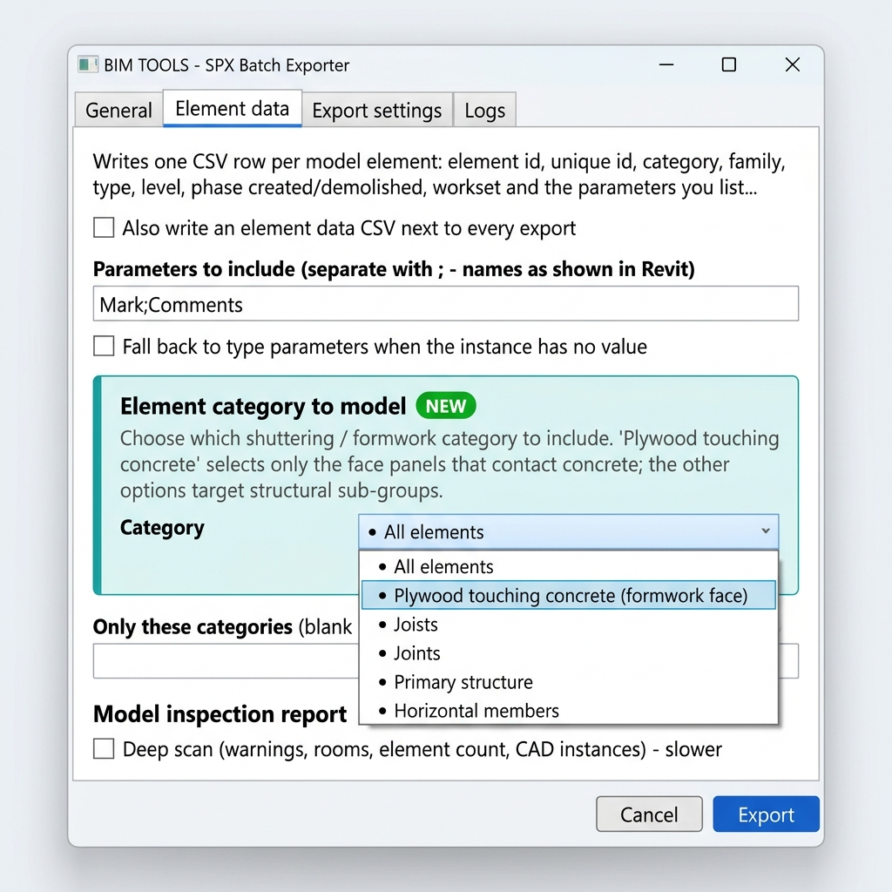
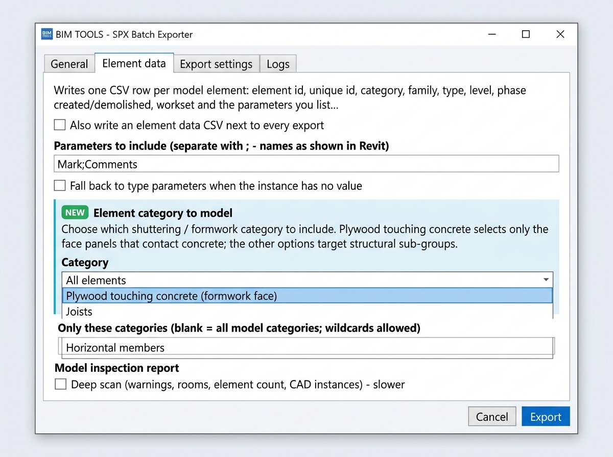

# BIM TOOLS - SPX Batch Exporter (Revit 2022 - 2026) v1.3

## Screenshots

### Element Category Selector — Full View
> New in v1.6 · **Element data** tab · Choose which shuttering / formwork element category to model

### Element Category Selector — Compact View

---

A Revit 2022 - 2026 add-in (C#, .NET Framework 4.8, WPF, MVVM). It adds a **BIM TOOLS** ribbon tab with an **SPX Export** panel
and exports whole folder trees of Revit models to SYNCHRO 4D **.spx**, unattended, **beside each original .rvt file**.
No Navisworks is used or required.

## How SPX is produced

`.spx` is Bentley's proprietary SYNCHRO format; Revit has no API to write it. The SYNCHRO 4D Revit exporter installed
on your machine is the only thing that can create it. This add-in automates that exporter completely:

1. Scans the root folder and sub-folders for `.rvt` files (backup files skipped).
2. Opens each model in Revit 2022 - 2026 (detached copy of workshared models, workset filters, audit option, warnings dismissed).
3. Picks or creates the 3D view (**orthographic or perspective**), prepares it (detail level, hidden categories, phase) and activates it.
4. Runs the SYNCHRO exporter (auto-detected from its `.addin` manifest or your Revit journals).
5. Answers the exporter's own dialogs through UI Automation: types `<model folder>\<model name>.spx` in the Save / folder
   dialog, selects **shared or project coordinates**, presses Save / OK / Yes, so nothing waits for you.
6. Detects the new `.spx`, closes the model, moves to the next one, restores your original model.

Every dialog the exporter shows is written to the log with its control names. If the exporter has a prompt the defaults
don't cover, add a rule on the SYNCHRO (SPX) tab (`Label=Value;Checkbox name;...`) or send me the log line.

## Buttons

| Button | Purpose |
|---|---|
| Batch SPX Export | Main window. **Auto-export folder tree...** queues everything under a folder and saves beside each original |
| Export Active | Export the open model with the last-used settings |
| Model Inspector | Batch QA report (version, worksets, links, warnings, element counts) |
| Element Data | CSV of element ids, categories, levels, phases, worksets, chosen parameters (for linking schedules / WBS) |
| Open Logs / About | Logs folder, version |

## Options

- Coordinates: shared (survey) or project (internal origin) | View: orthographic or perspective
- Detach from central, workset filters, audit, retries, continue on error, overwrite / skip / keep-both
- View preparation: detail level, hide rooms / grids / levels / links / markers / categories / worksets, phase and phase filter (4D)
- Naming tokens `{ModelName} {Date} {Time} {DateTime} {RevitVersion} {SourceVersion} {ViewName} {User} {Index}`
- Zip archive, secondary copy folder, HTML + CSV report, program to run when finished, completion sound
- Schedule (start overnight), filter / sort / import / save model lists, pre-flight check, presets list

## Build

1. Open `BimTools.SpxExporter.sln` in Visual Studio 2022 (.NET Framework 4.8 targeting pack).
2. References `RevitAPI.dll` / `RevitAPIUI.dll` from `C:\Program Files\Autodesk\Revit 2022 - 2026\` (override with
   `/p:RevitInstallDir=...`); without Revit installed it restores the `Nice3point.Revit.Api.*` 2024 NuGet packages.
3. Build (Revit closed). The post-build step copies the DLL and `BimTools.SpxExporter.addin` to
   `%ProgramData%\Autodesk\Revit\Addins\2024\`. Start Revit 2022 - 2026 and open the **BIM TOOLS** tab.

## Architecture

`Models` (settings, items, enums) - `ViewModels` - `Views` (WPF) - `Engines` (`IExportEngine`: SYNCHRO, Element data,
Inspection, IFC) - `Services` (opening, view resolution/preparation, dialog automation, reports, `BatchRunner`, which
advances one step per Revit `Idling` event) - `Commands` (`IExternalCommand`) - `Startup` (`IExternalApplication`, ribbon).

## Revit 2022 - 2026 (v1.4)

One code base builds for every version:

| Revit | Target framework |
|-------|------------------|
| 2022, 2023, 2024 | .NET Framework 4.8 |
| 2025, 2026 | .NET 8 (net8.0-windows) |

* Visual Studio: pick the solution configuration `Release R2022` ... `Release R2026` and build.
* Command line: `dotnet build -c Release -p:RevitVersion=2025`, or run `Build-All.ps1` to build and install all five.
* The Revit API is referenced from `C:\Program Files\Autodesk\Revit <year>\` when installed, otherwise restored from NuGet (Nice3point packages).
* Each build deploys to `%ProgramData%\Autodesk\Revit\Addins\<year>\` and writes to `bin\R<year>\`.
* The running Revit year is detected at startup (SYNCHRO manifest lookup, file-version checks and `{RevitVersion}` naming all follow it).
* The SYNCHRO 4D Revit plugin for the matching year must be installed for SPX export.

## Level of detail and graphic display (v1.5)

Tab **View preparation** now controls how the 3D view looks when SYNCHRO exports it (applied in memory to temporary views, or to existing views when "Also prepare existing 3D views" is ticked; nothing is saved to your models):

* Detail level: Keep / Coarse / Medium / Fine.
* Visual style: Wireframe, Hidden Line, Shaded, Consistent Colors, Textures, Realistic; Show edges on/off for Shaded.
* Discipline (Architectural, Structural, Mechanical, Electrical, Coordination), parts visibility, section box on/off.
* Surface transparency 0 - 100 % for all model categories.
* Hide annotation, imported (DWG/DGN/image) and analytical categories, plus rooms, grids/levels, links, view markers, named categories and worksets.

Fixed: the Detail level and View projection drop-downs were empty in the previous build.

## Element category selector (v1.6)

New **"Element category to model"** section in the **Element data** tab lets the user select exactly which formwork / shuttering category to export, without typing raw Revit category names:

| Option | Revit categories matched |
|---|---|
| All elements | *(no filter — every model element)* |
| Plywood touching concrete | `Generic Models`, `*Plywood*`, `*Formwork*`, `*Form*` |
| Joists | `*Joist*`, `Structural Framing` |
| Joints | `*Joint*`, `*Connection*` |
| Primary structure | `Structural Columns`, `Structural Walls`, `Walls`, `Columns` |
| Horizontal members | `Floors`, `Structural Floors`, `Roofs`, `*Slab*`, `*Deck*` |

The free-text "Only these categories" field still takes priority when filled in. Patterns can be customised in `Services/ElementDataExporter.cs → ResolveCategoryFilter()`.
